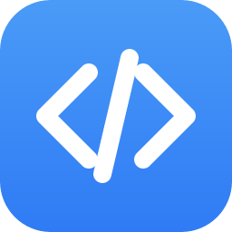

<p align="center"></p>
<p align="center"><a href="https://buymeacoffee.com/vancete"></a></p>

# CodeCraft

A small, fast-starting code editor written in Rust with [egui](https://github.com/emilk/egui). It is a sibling of [gitcraft](https://github.com/Vancete/gitcraft) and shares its look: the same dark theme, tab strip, menus and Lucide icons.

## Features

- **VS Code-like layout**: an activity bar on the left (Explorer, Search, Extensions, and at the bottom Terminal and Settings), a file tree of the open folder, editor tabs along the top and a status bar. Settings opens as a tab of its own.
- **Explorer menu**: right-click a file, a folder or the empty space for New File, New Folder, Reveal in File Explorer (Finder), Cut, Copy, Paste, Copy Path, Copy Relative Path, Rename and Delete. New names and renames are typed in the tree, as in VS Code; Delete sends to the Recycle Bin (trash) after asking, and open tabs follow renamed or moved files.
- **Find in the file** (Ctrl+F, Ctrl+H to replace): VS Code's find bar over the editor, with match case, whole word and regular expression (Alt+C, Alt+W, Alt+R), "3 of 12", Enter / Shift+Enter (or F3 / Shift+F3) to move between matches, and replace one or all. Regular expression replacements can use `$1`.
- **Search in the folder** (Ctrl+Shift+F, Ctrl+Shift+H to replace): the side panel's Search view, with the same options, files to include and exclude (globs such as `*.rs, src/**`), and the matches grouped by file; a click opens the file at the match. The folder is searched in the background, skipping what `.gitignore` lists. Replace All asks first, then changes the files (open ones in the editor).
- **Terminal** (Ctrl+`): gitcraft's built-in terminal in a panel under the editor, one tab per shell, started in the open folder. The shell is chosen in the settings.
- **Editor**: a monospace editor with line numbers, a highlighted cursor line and syntax colouring ([syntect](https://github.com/trishume/syntect), re-coloured incrementally while you type). Files with CRLF line endings keep them when saved.
- **Tabs**: one per open file, with its file-type icon. A dot marks unsaved changes, and CodeCraft asks before it closes a tab or the window with unsaved work. Tabs can be dragged to reorder them. A single click in the explorer opens a file in the *preview* tab (its name in italics), which the next file opened that way replaces; a double click, an edit or a double click on the tab keeps it. Preview tabs can be turned off in the settings.
- **Quick open** (Ctrl+P): type part of a file's name or path to find it in the open folder, ranked as VS Code does; Enter opens it.
- **Themes**: *Settings → Themes* shows each theme with a sample of code in its colours; a click picks it. CodeCraft has four of its own (Orchard, the default, Ember, Quiet and Tide), which keep the window in gitcraft's Dark, Medium Gray or Light look (the palette button). *Import VS Code themes…* lists the colour themes installed in VS Code (VS Code, VS Code Insiders and VSCodium are looked for); the ones picked appear under *VS Code Themes*, and choosing one colours the code and the whole window with it.
- **Command palette** (Ctrl+Shift+P): the same box as quick open, listing the commands extensions add.
- **Extensions** (Ctrl+Shift+X): scripts in [Luau](https://luau.org) that add commands, each in a folder of its own in `extensions/` next to the executable (the folder button in the Extensions view opens it). An extension is a folder with an `extension.json`:

  ```json
  { "name": "Tabify", "version": "1.0.0", "description": "Re-indents the open file with tabs instead of spaces.", "icon": "icon.svg", "main": "main.lua" }
  ```

  and its script, which sees a `codecraft` table: `codecraft.command(id, title, run)` adds a command, `run(doc)` gets the open file as `{ text, name, path }` and returns its new text (or nothing to leave it); `codecraft.notify(message)` shows a note. Extensions start **disabled**: nothing runs until you enable it in the Extensions view. Scripts run sandboxed: no files, network or processes, no `require`, read-only globals, and a command is stopped after 3 seconds. The example `extensions/tabify` (copied next to the executable when building) adds *Tabify: Format Document with Tabs*.
- **Opening files**: drop files or folders on the window to open them. A file opened from the system's file manager (or `codecraft <file>`) while CodeCraft is running opens in a tab of that window instead of a second one.
- **Updates**: checks GitHub every 12 hours for a newer release and shows a pill to download it (can be turned off in the settings).
- **Session**: the open folder, the open files, the expanded folders and the settings are restored on the next start.

## Download

Ready-made builds for Windows, Linux (x86-64) and macOS (Apple silicon and Intel) are on the
[releases page](https://github.com/Vancete/codecraft/releases).

- **Windows:** `codecraft-…-setup.exe` installs it for your user (no administrator rights), with a
  Start menu entry, an optional desktop icon, CodeCraft in _Open with_, optional _Open with
  CodeCraft_ on files and _Open in CodeCraft_ on folders, the example extensions and an
  uninstaller. The `.zip` is the same program without installing.
- **Linux:** `codecraft-….deb` (Debian, Ubuntu, Mint…) and `codecraft-….rpm` (Fedora, openSUSE…)
  install it with its applications menu entry, from the software centre or with
  `sudo apt install ./codecraft-….deb` / `sudo dnf install ./codecraft-….rpm`.
  `codecraft-….AppImage` runs on any distribution: make it executable (`chmod +x`) and run it.
  The `.tar.gz` holds the bare binary, a `.desktop` file and the example extensions.
- **macOS** (11 or later): open `codecraft-…-macos-universal.dmg` and drag CodeCraft to
  Applications; the `.zip` holds the same app. It isn't notarized by Apple, so the first time
  macOS refuses to open it: go to _System Settings › Privacy & Security_ and click _Open
  Anyway_, or run `xattr -dr com.apple.quarantine /Applications/codecraft.app`.

Only the Windows `.zip` and installer and the Linux `.tar.gz` bring the example extensions; with
the other packages the executable's folder isn't meant to be written to.

A release is built by `.github/workflows/release.yml` whenever a `v*` tag is pushed
(`packaging/windows/codecraft.iss` for the installer, `packaging/linux/build-appimage.sh` for the
AppImage, `[package.metadata.deb]` / `[package.metadata.generate-rpm]` in `Cargo.toml` for the
packages, `packaging/macos/build-app.sh` for the universal app, its `.dmg` and `.zip`).

## Usage

```bash
cargo run --release -- [folder-or-file]
```

| Shortcut | Action |
|---|---|
| Ctrl+P | Go to a file |
| Ctrl+Shift+P | Command palette |
| Ctrl+O | Open a folder |
| Ctrl+F / Ctrl+H | Find / replace in the file |
| Enter, F3 / Shift+Enter, Shift+F3 | Next / previous match |
| Ctrl+Shift+F / Ctrl+Shift+H | Search / replace in the folder |
| Ctrl+Shift+E | Explorer |
| Ctrl+Shift+X | Extensions |
| Ctrl+` (Ctrl+Ñ on a Spanish keyboard) | Show or hide the terminal |
| Ctrl+Shift+` | New terminal |
| Ctrl+S | Save |
| Ctrl+W | Close the tab |
| Ctrl+Tab / Ctrl+Shift+Tab | Next / previous tab |
| Ctrl+B | Show or hide the side panel |
| Ctrl+, | Settings |

## Development

```bash
cargo clippy --all-targets
cargo test
```

`examples/ui_shot.rs` takes headless screenshots driven by a small script of clicks and keys (see the comment at its top), for checking the UI without a window:

```bash
cargo run --release --example ui_shot -- . shots/ui open:src/app.rs ckey:F type:self shot
```

`examples/make_icon.rs` renders `assets/app-icon/codecraft.svg` into the PNG and ICO files.

## Licence

MIT or Apache-2.0, at your option. Bundled fonts and icons: see [ATTRIBUTION.md](ATTRIBUTION.md).
